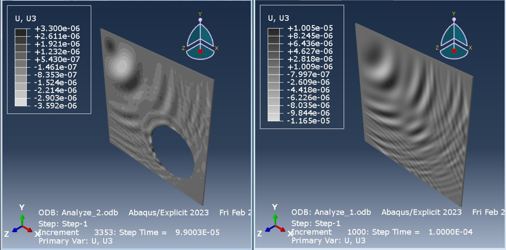

# Lamb Wave Simulation for Defect Detection

A group finite element project comparing Lamb-wave propagation in intact and perforated aluminum plates using **Abaqus/Explicit**. The study examines out-of-plane displacement histories and wave scattering as indicators of structural discontinuities.

**Group 11:** Pouya Asghari, Mehdi Gharibshahi, and Arash Bakhtiari. **Instructor:** Dr. Ganjiani. **Date:** Winter 1404 (Iranian calendar). Individual task allocation is not specified in the source report.

New to GitHub? Follow the [upload walkthrough](docs/GITHUB_GUIDE.md).

## Objective

Compare wave patterns and received signals in an intact aluminum plate, a plate with a large off-center circular hole, and a plate with a smaller central hole. The application context is nondestructive testing (NDT) and structural health monitoring (SHM).

## Model overview

| Parameter | Documented setting |
| --- | --- |
| Plate dimensions | 100 × 100 × 1 mm |
| Large hole | Radius 25 mm; center 30 mm from bottom and right edges |
| Small hole | Central; exact radius not specified |
| Source | 10 mm from top and left edges |
| Sensor | 10 mm from bottom and right edges |
| Boundary conditions | Perimeter translations fixed: U1 = U2 = U3 = 0 |
| Excitation | Concentrated out-of-plane force, CF3 = 1, with tabular pulse |
| Analysis | Dynamic, Explicit; duration 0.1 ms |
| Maximum time increment shown | 1e-7 s |
| Approximate global seed shown | 1 model length unit |
| Output | Sensor U3 history and displacement fields |

Material screenshots show E = 62000, Poisson's ratio = 0.33, and density = 2.7e-9. These are consistent with N–mm–s–tonne units (E in MPa and density in tonne/mm³), but the native model is unavailable to confirm that interpretation. The report's displacement-unit ambiguity is documented separately.

## Methods

- Three-dimensional finite element modeling in Abaqus/Explicit.
- Concentrated pulse excitation and out-of-plane displacement monitoring.
- Comparison of intact, large-hole, and smaller-hole configurations.
- Sensor-history overlays and animations of wave propagation.

## Results and scope

The supplied figures show differences in wave patterns and late-time sensor histories when a hole is present. The source attributes these to scattering, reflections, and interference, and discusses both initial attenuation and later amplification.

The repository provides a qualitative simulation study. It does not establish quantitative detection accuracy, experimental validation, mode identification, defect localization, or optimized sensor placement. No native simulations were rerun during translation. See [technical notes](docs/TECHNICAL_NOTES.md).

## Files

| Path | Contents |
| --- | --- |
| [report/main.pdf](report/main.pdf) | English translation with 29 figure groups and separate editorial notes |
| [report/main.tex](report/main.tex) | Editable LaTeX source |
| `report/figures/` | Original embedded report images, including Word fallback copies |
| [report/BUILD.md](report/BUILD.md) | Compilation instructions |
| [videos/Fullplate.mp4](videos/Fullplate.mp4) | Intact-plate simulation video |
| [videos/PerforatedPlate.mp4](videos/PerforatedPlate.mp4) | Large-hole simulation video |
| [videos/SmallHole.mp4](videos/SmallHole.mp4) | Smaller-hole simulation video |
| [data/pulse_from_report.csv](data/pulse_from_report.csv) | Tabular excitation transcribed from a source screenshot |
| `models/` | Instructions for adding native CAE and INP files later |
| `code/` | Instructions for adding separately stored scripts later |
| [docs/REPRODUCING.md](docs/REPRODUCING.md) | Reconstruction workflow and missing inputs |

## Software and reproduction

The supplied video frames identify Abaqus/CAE and Abaqus/Explicit 2023. A compatible licensed installation is needed to recreate or run the models. The English PDF and videos can be viewed without Abaqus.

**The uploaded archive contains no CAE, INP, ODB, simulation scripts, or raw sensor histories.** The models and code folders therefore contain instructions, not a runnable model. Add the original files when available and document their execution order. Use [REPRODUCING.md](docs/REPRODUCING.md) as a checklist.

## Build the English report

Upload the report-only LaTeX ZIP to Overleaf, choose `main.tex`, and compile with pdfLaTeX. Keep `figures/` beside the source. No custom font or bibliography file is needed. References are embedded in the LaTeX source. See [BUILD.md](report/BUILD.md).

## Attribution and translation

This is a three-person group project; all original contributors are credited above. Confirm collaborators' preferred Romanized name spellings before publication. The Persian report was translated with AI assistance. The geometry schematic was redrawn with English labels, and reproduction notes were added separately. Original screenshots and video bytes are preserved.

The source's first bibliographic entry lists Rose's *Ultrasonic Waves in Solid Media* with a 2014 year. The translation explicitly corrects this to 1999 using the publisher's front matter. Other source references are retained without claiming they were independently reviewed.

## License

No project license has been selected. Agree on reuse permissions with the project contributors before adding a license. Abaqus and referenced third-party materials retain their own terms.
